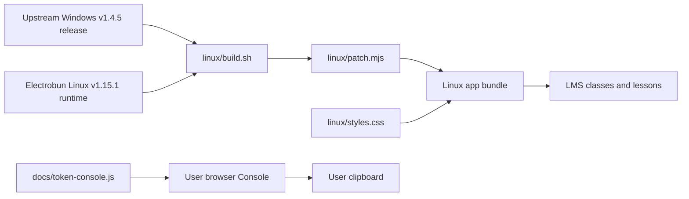

# LBUNS Second Brain

## Architecture

The upstream Git repository contains release metadata and question-bank data, not the application source. The Linux build verifies SHA-256 hashes before extracting and patching the v1.4.5 release bundle. It does not commit the Windows or Linux binaries.

## Directory map

| Path | Purpose |
| --- | --- |
| `bank/` | Published question-bank data and signatures |
| `updates/` | Signed Windows update manifests |
| `linux/build.sh` | Reproducible, version-pinned Linux repack |
| `linux/patch.mjs` | Verified v1.4.5 backend/HTML patch; auto-load and prefetch lessons |
| `linux/styles.css` | Side-by-side lessons/tasks on wide windows |
| `linux/run.sh` | Launch with Linux-specific data and runtime paths |
| `docs/token-console.js` | Copy the current user's LMS Bearer token from browser requests |
| `tests/token-console.test.mjs` | Fetch/XHR clipboard-hook regression tests |

## Configuration matrix

| Setting | Default | Meaning |
| --- | --- | --- |
| `LBUNS_DATA_DIR` | `~/.local/share/LBUNS-Linux/Data` | Linux user data directory |
| `LBUNS_QUIZ_DIR` | `<app>/quiz` | Bundled quiz data path |
| `LBUNS_DEMO` | unset | Set to `1` for an offline demo |
| Build output argument | `linux/dist/LBUNS-v1.4.5-linux.1` | Optional output path for `linux/build.sh` |
| Layout breakpoint | 1000 px | Wide windows show two columns |
| Lesson prefetch concurrency | 2 classes | Limits simultaneous background LMS calls |

## PR log

| Change | Base | Status |
| --- | --- | --- |
| [#2 Linux v1.4.5.1, Console token script, lesson prefetch, two-column layout](https://github.com/cecon123/lbuns/pull/2) | `main` (upstream has no `dev`) | Open |
